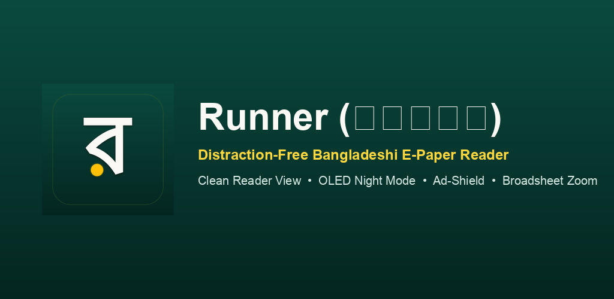

# Runner (রানার) — Distraction-Free Bangladeshi E-Paper Reader

<p align="center">
  
</p>

<p align="center">
  <a href="https://github.com/ibrahimhasan0012/runner-epaper/releases/latest"></a>
  
  
  
  
  <a href="LICENSE"></a>
  
</p>

<p align="center">
  <strong>An open-source, privacy-respecting client for browsing official physical print editions (E-Papers) of Bangladesh's leading newspapers without clutter, popups, or paywalls.</strong>
</p>

<p align="center">
  <a href="#-downloads">Download APK</a> •
  <a href="#-features">Key Features</a> •
  <a href="#-supported-newspapers">Supported Newspapers</a> •
  <a href="#-building-from-source">Building from Source</a> •
  <a href="#-privacy--security">Privacy Policy</a>
</p>

---

## 📖 Overview

In Bangladesh, physical newspapers publish daily digital broadsheet replicas ("E-Papers"). However, reading them on mobile browsers is frequently hindered by aggressive overlay popups, intrusive trackers, and rigid desktop viewports.

**Runner (রানার)**—named in homage to Sukanta Bhattacharya's iconic poem celebrating the tireless courier of morning news—provides a polished, distraction-free reading stand. It strips away interstitial clutter, provides ergonomic zooming, offers a night reading filter, and preserves your reading history natively on your device.

---

## ✨ Features

- 🛡️ **Intelligent Ad-Shield Engine**: Blocks third-party ad networks (`doubleclick`, `googlesyndication`, `taboola`, `eskimi`, `purplepatch`, etc.) at the navigation layer while injecting mutation observers to clear sticky video overlays and banners.
- 🌙 **Smart Night Reading Mode**: Intelligent CSS filter that inverts white broadsheet canvas backgrounds into dark parchment while preserving the original natural colors of photographs and graphics.
- 🔍 **Broadsheet Zoom & Fit Controls**: Dedicated floating zoom dock (`+`, `1x`, `-`) enabling effortless reading of fine print columns without pinch jitter.
- 📅 **Edition Archive Picker**: Calendar date-picker to easily jump back to previous dates and read historical editions.
- 🎨 **Dual Editorial Design System**:
  - **Warm Newsprint (Light Mode)**: Inspired by physical parchment (`#F9F7F2`) with deep forest emerald accents (`#004D40`).
  - **OLED Midnight (Dark Mode)**: True dark background (`#121212`) paired with refined Bangla typography ([Google Fonts *Hind Siliguri*](https://fonts.google.com/specimen/Hind+Siliguri)).
- 📱 **Broadsheet vs. Mobile Viewport Switch**: Dynamically toggles between desktop user-agent broadsheets and responsive mobile layouts.
- 💾 **100% Local Persistence**: Favorites, last-read papers, and theme choices are stored on-device using native `SharedPreferences`.
- 🚀 **Native Sharing**: One-tap native system share sheet via `share_plus` to send article links directly via WhatsApp, Messenger, or Twitter.

---

## 📥 Downloads

Ready-to-install release binaries are signed with a production keystore (supporting APK Signature Scheme v2/v3, targetSdk 35, and Android 15/16/17 compatibility):

| Variant | Architecture | Size | Download | Compatibility |
| :--- | :--- | :--- | :--- | :--- |
| **Universal Release APK** | All ABIs (Fat APK) | ~52 MB | [**Download APK**](https://github.com/ibrahimhasan0012/runner-epaper/releases/download/v1.0.0/Runner-release.apk) | Recommended for all Android devices |
| **ARM64-v8a Release APK** | 64-bit ARM | ~20 MB | [**Download APK**](https://github.com/ibrahimhasan0012/runner-epaper/releases/download/v1.0.0/Runner-arm64.apk) | Optimized for modern phones & Pixel |

> **Note**: For sideloading on Android 14+, simply allow installation from your file manager or browser.

---

## 📰 Supported Newspapers

Runner provides direct indexed access to official broadsheet portals across major national categories:

### Top National Dailies
- **যুগান্তর (Daily Jugantor)** — Complete daily broadsheet, no login required.
- **কালের কণ্ঠ (Kaler Kantho)** — Direct full print edition.
- **সমকাল (Daily Samakal)** — Full physical broadsheet replica.
- **দৈনিক ইত্তেফাক (The Daily Ittefaq)** — Historic national publication.
- **বাংলাদেশ প্রতিদিন (Bangladesh Pratidin)** — Highest circulation daily print edition.
- **দৈনিক নয়া দিগন্ত (Daily Naya Diganta)** — Direct daily broadsheet.
- **দৈনিক ইনকিলাব (Daily Inqilab)** — Full broadsheet access.
- **প্রথম আলো (Prothom Alo)** — Official e-paper reader (free daily account support).
- **আজকের পত্রিকা (Ajker Patrika)** — Regional and national coverage.
- **দেশ রূপান্তর (Desh Rupantor)** — Complete daily edition.
- **দৈনিক জনকণ্ঠ (Daily Janakantha)** — National daily broadsheet.
- **যায়যায়দিন (Daily Jaijaidin)** — Full print edition.
- **ভোরের কাগজ (Bhorer Kagoj)** — Free broadsheet edition.

### English Dailies
- **The Daily Star** — Bangladesh's premier English-language broadsheet.
- **The Business Standard (TBS)** — In-depth business, economy, and financial analysis.

### Business & Economy
- **বণিক বার্তা (Bonik Barta)** — Bangladesh's leading business and commerce publication.

---

## 🏗️ Architecture & Tech Stack

```text
lib/
├── data/
│   └── newspapers_data.dart        # Curated catalog of verified e-paper portals
├── models/
│   └── newspaper.dart              # Newspaper domain entity & access models
├── screens/
│   ├── home_screen.dart            # Animated newsstand grid with live Bangla date
│   └── epaper_reader_screen.dart   # Broadsheet webview reader with zoom & night filter
├── services/
│   ├── ad_blocker_service.dart     # JS/CSS clean-reader & domain filtering engine
│   └── storage_and_share_service.dart # SharedPreferences & native share integration
└── main.dart                       # App initialization & dynamic theme switcher
```

- **Framework**: [Flutter](https://flutter.dev) (Dart 3.x)
- **Web Rendering**: [`webview_flutter`](https://pub.dev/packages/webview_flutter)
- **Animations**: [`flutter_animate`](https://pub.dev/packages/flutter_animate)
- **Typography**: [`google_fonts`](https://pub.dev/packages/google_fonts) (*Hind Siliguri*)
- **Local Persistence**: [`shared_preferences`](https://pub.dev/packages/shared_preferences)
- **Native Sharing**: [`share_plus`](https://pub.dev/packages/share_plus)
- **Play Core Support**: `com.google.android.play:integrity:1.4.0`

---

## 🚀 Building from Source

### Prerequisites
- [Flutter SDK](https://docs.flutter.dev/get-started/install) (version 3.2.0 or higher)
- Android SDK with platform tools (API 35/36)
- Java 17+

### Steps
```bash
# 1. Clone the repository
git clone https://github.com/ibrahimhasan0012/runner-epaper.git
cd runner-epaper

# 2. Install dependencies
flutter pub get

# 3. Run the app in debug mode
flutter run

# 4. Build a signed Universal Release APK
flutter build apk --release

# 5. Build an Android App Bundle (.aab)
flutter build appbundle --release
```

---

## 🔐 Privacy & Security

Runner is built on strict privacy-first principles:
- **Zero Telemetry**: We do not collect, store, or transmit any user data, identifiers, or analytics.
- **Local-Only Preferences**: Bookmarked favorites, last-read papers, and theme choices never leave your device.
- **Direct Web Access**: Connections to e-paper portals occur directly between your device and the respective official publisher websites.

---

## ⚖️ Legal Disclaimer

*Runner is an independent, open-source reader client that indexes publicly accessible web portals operated by newspaper publishers. All trademarks, mastheads, logos, and newspaper contents belong entirely to their respective copyright holders. Runner does not host, reproduce, relicense, or redistribute any copyrighted news publications.*

---

## 📄 License

This project is open-source software licensed under the **[MIT License](LICENSE)**.
